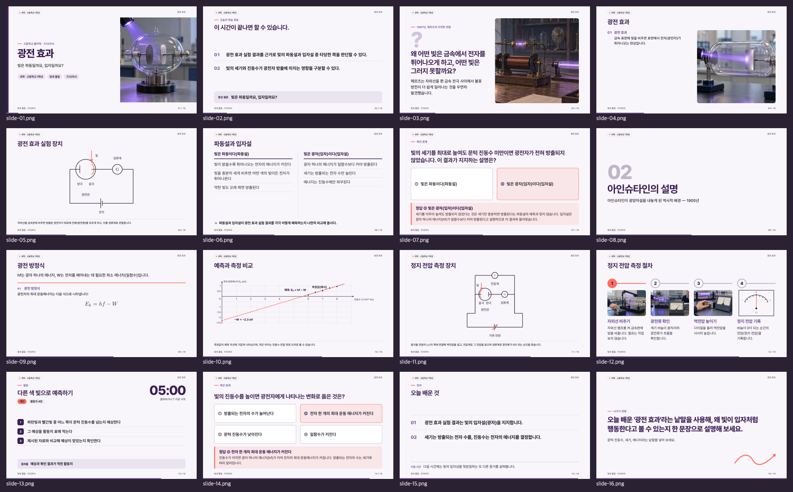
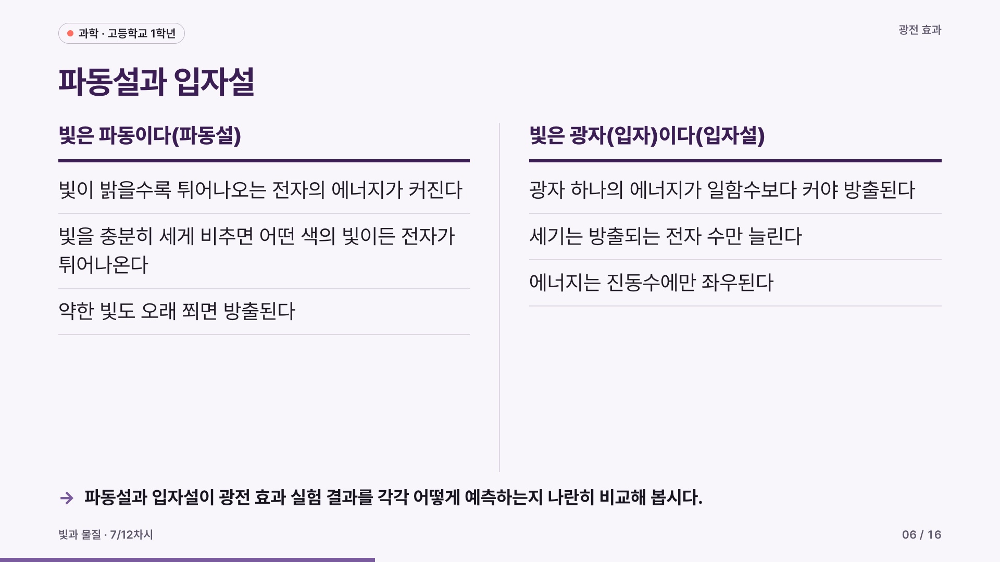
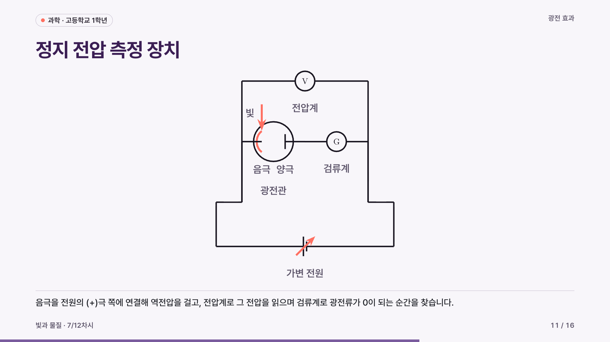
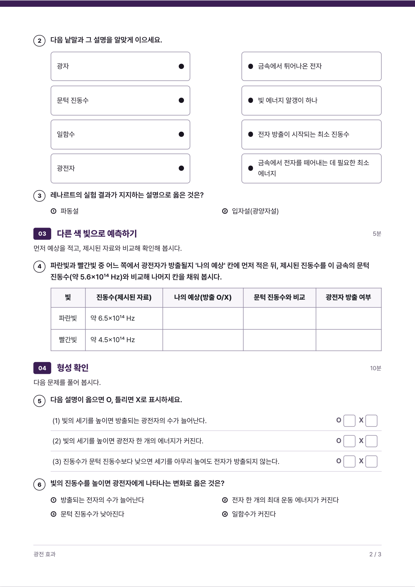
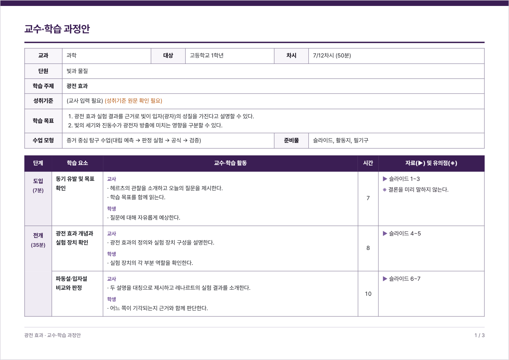
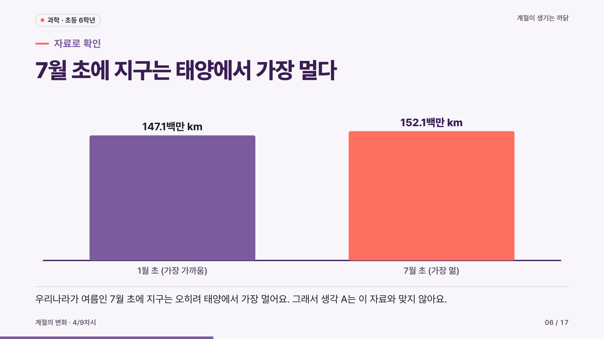
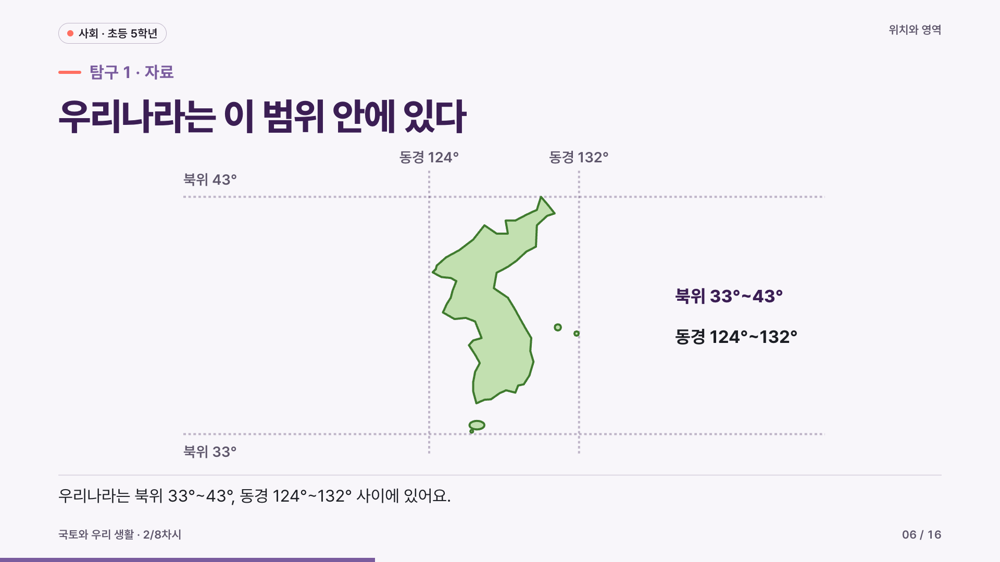
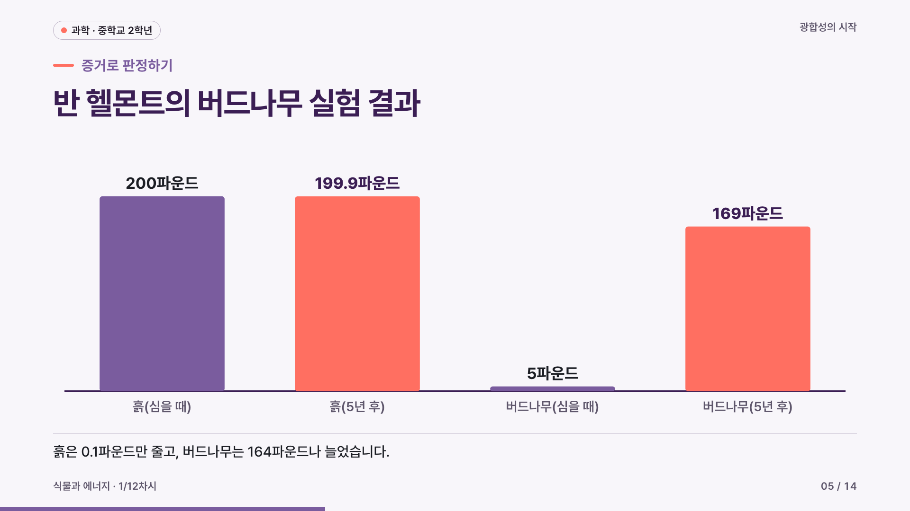
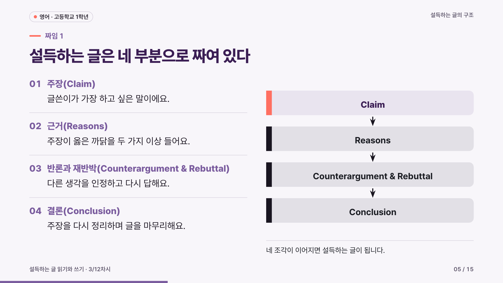

<div align="center">

# 🎓 classforge

### 수업 설계서 한 장으로, 교실에서 바로 쓰는 수업 자료 한 벌

수업 슬라이드 · 학생 활동지 · 정답지 · 교수·학습 과정안을 함께 만들고<br>
20개 자동 품질 게이트와 별도 검토자의 도메인 검토까지 통과시키는 [Claude Code](https://claude.com/claude-code) 스킬입니다.


[💬 결과 예시](#-이렇게-요청하면-이렇게-만들어집니다) · [📝 설계서](#-수업-설계서) · [📦 설치](#-설치) · [⚙️ 동작 방식](#️-동작-방식) · [⚠️ 주의](#️-주의)



<sub>교사가 일부만 채운 설계서(<code>examples/photoelectric/수업설계서.txt</code>)를 스킬을 처음 본 에이전트가 받아 만든 16장입니다.</sub>

</div>

<br>

## 🤔 왜 classforge 인가?

> **그럴듯하지만 틀린 수업 자료를 교실에 내보내지 않으려고 만들었습니다.**

AI에게 수업 자료를 맡기면 금방 만들어 주지만 그대로 쓰기는 어렵습니다. 눈금이 맞지 않는 그래프, 배선이 끊긴 회로도, 출처를 알 수 없는 수치, 활동지에 그대로 찍혀 나온 정답, 프로젝터에서 넘쳐 잘리는 글자 같은 문제가 섞여 나오기 때문입니다. 결국 교사가 한 장씩 다시 확인해야 합니다.

classforge는 그 확인을 코드로 옮겼습니다. **그림은 손으로 그리지 않고 계산해서 그리며**, 화면의 모든 수치는 출처가 있어야 하고, 실제 브라우저로 렌더링해 넘침·겹침·글자 크기를 잽니다. 20개 게이트를 모두 통과한 다음에는 **작성자가 아닌 별도 검토자**가 과학적 정확성을 한 번 더 봅니다.

<br>

## 💬 이렇게 요청하면, 이렇게 만들어집니다

Claude Code에 평소 말투로 요청하거나 채운 설계서를 건네세요. 아래는 모두 저장소에 들어 있는 예시를 실제로 빌드한 화면입니다.

| 📝 설계서 그대로 | 📐 계산해서 그린 삽화 | 🚦 20개 품질 게이트 |
|---|---|---|
| 채운 칸은 결과물에 반영됐는지 대조<br>비운 칸은 수업 설계 규칙으로 결정 | 그래프는 그래프 엔진, 회로·광학·지도는 TikZ<br>사진형 삽화만 생성 이미지 | 글자 수·명암·넘침·정답 분리·안전 문구<br>+ 별도 검토자의 도메인 검토 |

### ⚡ "고1 물리 광전 효과 7차시, 증거 중심으로 만들어 줘"

대립하는 두 설명(파동설·입자설)을 같은 형식으로 나란히 놓고, **다음 장에서** 실험 결과로 판정합니다. 판정 전에는 답을 드러내지 않습니다.

<table>
<tr>
<td></td>
<td></td>
</tr>
<tr>
<td></td>
<td></td>
</tr>
</table>

<sub>📎 설계서·lesson.json·검토 기록: [examples/photoelectric](examples/photoelectric)</sub>

### 📄 슬라이드만이 아닙니다 — 활동지와 지도안도 한 벌로

<table>
<tr>
<td></td>
<td></td>
</tr>
</table>

| 산출물 | 파일 | 특징 |
|---|---|---|
| 🖥️ 수업 슬라이드 | `slides.html` · `slides.pdf` | 교실 프로젝터용 16:9. 글꼴을 파일 안에 넣어 인터넷 없이 어느 PC에서나 같게 보임. →/Space 넘김, 단계 공개, 퀴즈 정답 공개, 활동 타이머(T), 발표자 노트(N) |
| ✏️ 학생 활동지 | `worksheet.pdf` | A4 자동 쪽 나눔. 정답 글자가 파일에 아예 들어가지 않음 |
| ✅ 정답지 | `answer-key.pdf` | 같은 배치에 정답 · 풀이 · 정답 그래프 · 채점 기준 |
| 📋 교수·학습 과정안 | `lesson-plan.pdf` | 도입 · 전개 · 정리, 평가 계획(상·중·하), 예상 질문, 다음 차시로 넘어가는 기준 |

### 🌏 교과를 가리지 않습니다

<table>
<tr>
<td><br><sub>초6 과학 · 계절의 변화 — 자료로 오개념 반박</sub></td>
<td><br><sub>초5 사회 · 국토의 위치 — 위도·경도로 그린 지도</sub></td>
</tr>
<tr>
<td><br><sub>중2 과학 · 광합성 — 출처 있는 역사 실험</sub></td>
<td><br><sub>고1 영어 · 설득하는 글 — TikZ 구조도</sub></td>
</tr>
</table>

### 🙅 모르는 것은 지어내지 않습니다

설계서에서 성취기준을 비우면 그럴듯한 문장을 지어내는 대신 `(교사 입력 필요)`로 남깁니다. 위 과정안의 성취기준 칸이 바로 그 경우입니다. 출처를 찾지 못한 역사적 사실도 지어내지 않고 표시하며, 그래프에 예시 값을 쓰면 라벨에 "(예시)"라고 밝힙니다.

### 💡 이렇게 요청해 보세요

```
중2 수학 일차함수의 그래프 3차시 수업 자료 만들어 줘
이 수업 설계서대로 만들어 줘  (수업설계서.txt 첨부)
초6 과학 계절의 변화, 모둠 활동 넣고 활동지는 8문항으로
고1 물리 광전 효과, 증거 중심 스타일로 지도안까지
슬라이드만 12장, 해요체로
```

> [!TIP]
> - 📝 **설계서가 없어도 됩니다**: 꼭 필요한 것만 한 번에 물어보고, 교사가 말한 값만 기록합니다.
> - ★ **네 칸이면 충분합니다**: 성취기준 · 학습 목표 · 학생들이 자주 하는 잘못된 생각 · 꼭 넣을 것. 이 네 칸이 결과를 가장 크게 바꿉니다.
> - 🔬 **증거 중심 스타일**: "증거 중심으로"라고 하면 주장 옆에 실험·역사 근거를 붙이고, 대립 설명을 자료로 판정하는 탐구형 수업으로 만듭니다.

<br>

## 📝 수업 설계서

세 가지 중 **편한 방법 하나**로 넘기면 됩니다. 필요한 칸만 채우세요.

| 방법 | 이렇게 |
|---|---|
| 🌐 **브라우저 양식** | [`templates/수업설계서.html`](templates/수업설계서.html)을 더블클릭해 열고 칸을 채운 뒤 **저장하기** → 다운로드 폴더의 `수업설계서-교과-단원` 파일을 Claude에게 보냅니다. 인터넷 없이 동작하고, 시간 합·문항 수 같은 모순을 바로 알려 주며, 보고서 모양 그대로 인쇄할 수도 있습니다 |
| 🗒️ **메모장 파일** | [`templates/수업설계서.txt`](templates/수업설계서.txt)를 메모장으로 열어 `대상: 중2 3반 24명`, `활동: 모둠`처럼 낱말로 적습니다. `※`·`예)` 줄은 설명이라 지우지 않아도 됩니다 |
| 💬 **대화** | 파일 없이 "중2 광합성 4차시 만들어 줘"라고 하면, Claude가 꼭 필요한 것만 묻고 답을 `intake.json`으로 기록합니다 |

어느 방법이든 같은 `intake.json`이 됩니다. 비운 칸은 AI가 수업 설계 규칙으로 정하고, 채운 칸은 게이트 **S7**이 학생이 보는 화면·활동지에 실제로 반영됐는지 대조합니다. 예전 양식(`<!-- key: -->` 주석)으로 쓴 설계서도 그대로 읽힙니다.

```bash
node scripts/intake.mjs 수업설계서.txt                    # 채운 항목 / AI가 정할 항목, 모순 경고
node scripts/intake.mjs --check intake.json lesson.json   # 반영 검사 (자동 확인 / 사람 확인 분리)
```

<br>

## 📦 설치

설치하면 Claude Code의 모든 작업에서 classforge를 쓸 수 있습니다. 아래 세 방법 중 **하나만** 하면 됩니다.

### 1️⃣ Claude Code에게 부탁하기 ✨ 가장 쉬움

Claude Code에 아래 문장을 그대로 붙여 넣으세요.

```
https://github.com/sehunYang/classforge 를 내 Claude Code 스킬 폴더(~/.claude/skills/classforge)에 설치해줘. npm install과 pip install fonttools까지 하고, Chrome이나 Edge가 없으면 알려줘.
```

### 2️⃣ 명령 몇 줄

macOS · Linux:

```bash
git clone https://github.com/sehunYang/classforge ~/.claude/skills/classforge
cd ~/.claude/skills/classforge && npm install && python3 -m pip install fonttools
```

Windows (PowerShell):

```powershell
git clone https://github.com/sehunYang/classforge "$env:USERPROFILE\.claude\skills\classforge"
cd "$env:USERPROFILE\.claude\skills\classforge"; npm install; py -m pip install fonttools
```

### 3️⃣ 직접 복사

저장소를 내려받아 `~/.claude/skills/classforge`(Windows: `C:\Users\<사용자>\.claude\skills\classforge`)에 두고, 그 폴더에서 `npm install`과 `pip install fonttools`를 실행합니다. 한 프로젝트에서만 쓰려면 `<프로젝트>/.claude/skills/classforge`에 둡니다.

> [!NOTE]
> - **필요한 것**: Node 18+, Python 3, Chrome 또는 Edge. 다른 위치에 설치한 브라우저는 `CLASSFORGE_CHROME` 환경변수로 경로를 지정합니다.
> - **정밀 도식**(회로·광학·기하): MiKTeX나 TeX Live가 있으면 그것을 쓰고, 없어도 `npm install`이 받은 node-tikzjax가 자동으로 대신합니다. 둘 다 선택 사항입니다.
> - **사진형 삽화**: 생성 이미지를 쓰려면 Codex CLI(`npm i -g @openai/codex` 후 `codex login`)가 필요합니다. 그래프·도해만 쓰는 수업에는 필요 없습니다.

직접 실행할 수도 있습니다:

```bash
node scripts/build.mjs examples/season/lesson.json   # HTML · PDF · 캡처 → examples/season/out/
node scripts/gate.mjs  examples/season/lesson.json   # 20개 게이트
```

<br>

## ⚙️ 동작 방식

```
설계서 ─▶ intake.mjs ─▶ lesson.json ─▶ images.mjs     ─▶ build.mjs    ─▶ gate.mjs    ─▶ 별도 검토자    ─▶ 교사에게
(양식·파일·   모순 경고     거꾸로 설계     diagrams.mjs      HTML · PDF      20개 게이트     review.json       전달 · 회고
 대화)        intake.json  (목표→평가→활동) 생성 이미지·TikZ    캡처              │             + 캡처 육안 검수
                                ▲                                          │
                                └──────────────── FAIL이면 고쳐서 다시 ─────┘
```

| | |
|---|---|
| 📐 **삽화는 손으로 그리지 않음** | 손으로 쓴 `<svg>`는 게이트 **V1**이 막습니다. 좌표평면·막대그래프는 `{plot}`/`{bars}`로 선언하면 빌드가 눈금·축·라벨을 계산하고, 회로·광학·입자·작도·지도는 TikZ 도해 엔진으로 그립니다. 회로는 배선이 실제로 이어졌는지, 극성이 맞는지 빌드 때 검증합니다. |
| 🖼️ **생성 이미지는 사진형에만** | 표지·도입 장면·실물 사진처럼 정확한 값이 필요 없는 곳에만 씁니다. [공냥이 프롬프트 킷](https://github.com/gongnyang/gongnyang-prompt-kit) 형식으로 프롬프트를 검증한 뒤 Codex CLI(ChatGPT 구독 경로)로 만들고, 이미지 안에는 글자를 넣지 않습니다. 프롬프트 해시로 캐시해 다시 과금하지 않습니다. |
| 🔬 **증거 중심 스타일** | 한 고교 물리 교사의 실제 수업 자료에서 원칙만 옮겼습니다. 공식 옆에 근거 실험, 대립 설명은 다음 장에서 판정, 근거는 "예측 vs 측정", 오개념에는 진짜 역사적 사실. 게이트 **E1**이 검사합니다. |
| 🧪 **실험 안전** | 게이트 **S8**이 교과별 실험의 흔한 사고를 잡습니다. 에탄올은 물중탕, 아이오딘 반응은 탈녹말과 탈색, 향불 확인은 기체를 모으는 절차가 있어야 통과합니다. |
| 🔍 **도메인 검토** | 게이트가 못 잡는 그림의 정확성·캡션 불일치는 작성자가 아닌 검토자가 보고 `review.json`에 남깁니다. 게이트 **R1**은 검토 이후 내용이 바뀌었는지 해시로 확인합니다. |

<details><summary>🚦 품질 게이트 20개 전체 보기</summary>

| 구분 | 게이트 | 검사 |
|---|---|---|
| 정적 | S1 구조 · S2 글자 수 · S3 목표-평가 연결 · S4 수치 근거 · S5 문체 · S6 성취기준 · S7 설계서 반영 · S8 안전 | 필수 유형과 흐름, 학교급별 글자 수, 목표마다 평가 문항, 화면의 모든 수치가 출처 있는 `facts`에 있는지, 설계서 반영, 실험 절차의 안전 문구 |
| 스타일 | E1 증거 중심 | 데이터 검증 · 판정 근거와 구별력 · 역사 인용 · 스포일러 · 회로는 도해 엔진으로 |
| 이미지 | I1 | 프롬프트 검증 · 캐시 · 해상도 · 중복 파일 |
| 시각 정책 | V1 | 손그림 SVG 금지, 그래프/도해/이미지 세 갈래 강제 |
| 도메인 검토 | R1 | `review.json` 존재 · 미해결 "틀림" · 내용 해시 신선도 |
| 브라우저 실측 | B1 넘침·겹침 · B2 글자 크기·가림 · B3 명암 대비 · B4 글꼴 · B5 화면 밀도 · B6 A4 쪽 · B7 정답 분리 · B8 실행 오류 | 실제 렌더링을 재어 판정 |

자세한 규칙: [`references/gates.md`](references/gates.md)

</details>

<br>

## 📚 예시

| 폴더 | 수업 | 볼거리 |
|---|---|---|
| [`season`](examples/season) | 초6 과학 · 계절의 변화 | 기본 예시. 지구-태양 거리 자료로 오개념 반박, TikZ 각도·궤도 도해 |
| [`photoelectric`](examples/photoelectric) | 고1 물리 · 광전 효과 | 증거 중심. 교사 설계서(일부 기입), circuitikz 측정 회로, 도메인 검토 기록 |
| [`photosynthesis`](examples/photosynthesis) | 중2 과학 · 광합성 | 증거 중심. 반 헬몬트 실험, 교사 시범으로 처리한 향불 확인 |
| [`territory`](examples/territory) | 초5 사회 · 국토의 위치와 영역 | 위도·경도로 그린 단순화 지도, 법률 용어 정확성 검토 |
| [`argument-essay`](examples/argument-essay) | 고1 영어 · 설득하는 글의 구조 | 지문 슬라이드, TikZ 구조도 |
| [`linear-function`](examples/linear-function) | 중2 수학 · 일차함수의 그래프 | 선언형 그래프 |
| [`intake`](examples/intake) | 설계서 예시 | 메모장 양식 전체 기입 · 옛 양식 · 일부러 어긴 예 |

모든 예시는 게이트 ALL PASS이고 검토 기록(`review.json`)을 담고 있습니다. `out/`은 저장소에 없으니 `build.mjs`로 만드세요.

<br>

## 🗂️ 파일 구조

```
SKILL.md                 에이전트 작업 지침 (설계서 → lesson.json → 빌드 → 게이트 → 검토)
references/              설계 규칙 · lesson.json 형식 · 게이트 · 이미지 · 검토 기록 문서
templates/               슬라이드·인쇄 스타일, 수업 설계서 양식(.txt · .html)
scripts/                 intake · build · gate · images · diagrams · fonts
assets/fonts/            Pretendard (파일에 넣어 인터넷 없이 같은 모양)
vendor/prompt-kit/       이미지 프롬프트 형식 (MIT)
examples/                예시 수업 6개와 설계서 예시
docs/images/             README 이미지
```

<br>

## 🛠️ 만든 과정

강의 「ChatGPT Astra 업무자동화 사용법」(패스트캠퍼스, 2026-09-22)의 원칙 — 목적을 먼저, 레퍼런스는 구조만 읽기, 게이트는 물리적 브레이크, 작은 부품 조합, 회고 — 을 바탕으로 Claude Code에서 만들었습니다. 여러 에이전트가 구현을 나눠 맡고, 스킬 문서만 본 에이전트가 새 주제로 블라인드 테스트를 하고, 별도 평가자가 판정하는 루프를 기준을 넘을 때까지 반복해 8라운드 만에 통과했습니다. 남은 사소한 항목은 [RELEASE_NOTES.md](RELEASE_NOTES.md)에 있습니다.

<br>

## ⚠️ 주의

> [!WARNING]
> - 👩‍🏫 **최종 확인은 교사가**: 게이트와 검토를 거쳐도 AI가 만든 자료입니다. 수업 전에 내용과 수치를 직접 확인하세요.
> - 📜 **성취기준**: 설계서에 원문을 넣지 않으면 `(교사 입력 필요)`로 남습니다. 예시 수업의 성취기준도 원문 확인이 필요합니다.
> - 🖼️ **생성 이미지는 실제 사진이 아닙니다**: 표지·장면 연출용입니다. 정확한 장치 구성은 TikZ 도해를 기준으로 하세요.
> - 💳 **이미지 생성 비용**: 기본은 Codex CLI로 사용자의 ChatGPT 구독 쿼터를 씁니다. lesson.json에서 특정 모델을 지정하면 `OPENAI_API_KEY`로 별도 과금되는 API 경로를 씁니다.

<br>

## 📄 출처와 라이선스

- 코드: [MIT](LICENSE) © sehunYang
- 설계 참고: 공냥이(gongnyang) 공개 저장소 — deck-factory, awesome-html-scrolline-deck, bookforge, cardprinter, gongnyang-prompt-kit, gongnangi-chart-skill, data-literacy-with-ai (모두 MIT). 코드 복사 없이 구조·원칙만 참고했고, `vendor/prompt-kit/`은 MIT 라이선스와 함께 동봉했습니다. 정밀 도식은 MiKTeX/TeX Live(선택 설치, 동봉하지 않음) 또는 node-tikzjax(LPPL-1.3c)로 렌더링합니다. 자세히는 [CREDITS.md](CREDITS.md)
- 글꼴: [Pretendard](https://github.com/orioncactus/pretendard) — SIL Open Font License 1.1 (`assets/fonts/LICENSE-Pretendard-OFL.txt`)
- 예시 수업의 내용·삽화는 이 프로젝트에서 새로 만들었고, 사진형 이미지는 Codex로 생성했습니다.
